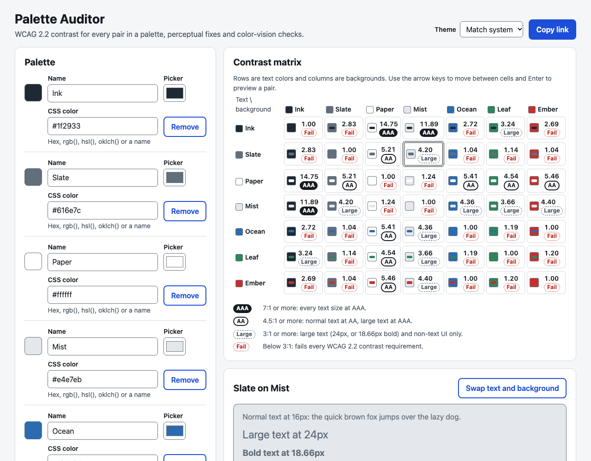
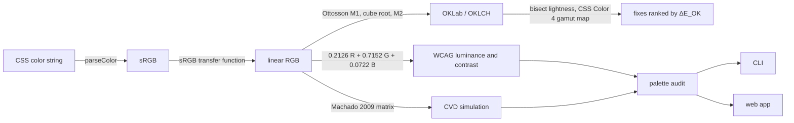

# contrastkit

**Accessible color, measured:** WCAG 2.2 contrast checks, perceptual (OKLCH) fixes for
failing pairs, color-vision-deficiency simulation and palette audits, as a TypeScript
library, a CLI for CI pipelines and a web app.

[](https://github.com/ult666666/contrastkit/actions/workflows/ci.yml)
[](LICENSE)
[](tsconfig.base.json)

**Live app:** [ult666666.github.io/contrastkit](https://ult666666.github.io/contrastkit/)



## Why

Most contrast checkers stop at "fails". Design teams then nudge colors by hand until the
number turns green, often drifting the hue. contrastkit measures WCAG 2.2 contrast exactly,
proposes the smallest perceptual change that passes, and flags color pairs that people with
color vision deficiencies cannot tell apart. Because the same checks run as a CLI, a
design-token change can fail CI the way a broken test does.

## Features

- **WCAG 2.2 contrast:** relative luminance, contrast ratio, and checks for SC 1.4.3 (AA),
  1.4.6 (AAA) and 1.4.11 (non-text). Translucent foregrounds are composited first, and
  ratios are never rounded up to pass.
- **Perceptual fixes:** the closest passing color found by binary search on OKLCH
  lightness in both directions, gamut-mapped, rounded to real hex values and ranked by
  ΔE_OK. Impossible targets return a typed `unachievable` result.
- **Color vision simulation:** protanopia, deuteranopia and tritanopia (Machado, Oliveira
  & Fernandes 2009).
- **Palette audits:** the pairwise contrast matrix, the levels each pair meets, and pairs
  that become hard to distinguish under each simulation.
- **Color parsing:** hex, `rgb()`, `hsl()`, `oklch()` and the 148 CSS named colors, with
  specific, typed errors. Conversions cover sRGB, linear sRGB, OKLab, OKLCH and HSL, plus
  CSS Color 4 gamut mapping.
- **CLI** with `check`, `fix` and `audit`, `--json` output and CI-friendly exit codes.
- **Palette Auditor web app:** keyboard-operable, screen-reader-friendly, light/dark, with
  state shareable through the URL.
- Zero runtime dependencies, ESM + CommonJS + type declarations, strict TypeScript.

## Quick start

contrastkit is not published to npm. Install the library and the `contrastkit` CLI from the GitHub release (Node 20 or newer):

```sh
npm install https://github.com/ult666666/contrastkit/releases/download/v0.1.0/contrastkit-0.1.0.tgz
npx contrastkit check 777 fff
```

Each release also attaches a SHA-256 checksum. Or build it from source:

```sh
git clone https://github.com/ult666666/contrastkit.git
cd contrastkit
npm ci
npm run build
```

### Library

[`examples/library.mjs`](examples/library.mjs):

```js
import {
  auditPalette,
  checkContrast,
  formatHex,
  formatRatio,
  simulateCvd,
  suggestFix,
} from 'contrastkit';

const result = checkContrast('#777777', '#ffffff');
console.log(`#777777 on white: ${formatRatio(result.ratio)}, AA text: ${result.aaText}`);

const fix = suggestFix('#777777', '#ffffff', { level: 'AA' });
if (fix.status === 'fixed') {
  const [best] = fix.candidates;
  console.log(
    `closest AA fix: ${best.hex} (${formatRatio(best.ratio)}, ΔE_OK ${best.deltaE.toFixed(3)})`,
  );
}

console.log(
  `#c53030 with deuteranopia looks like ${formatHex(simulateCvd('#c53030', 'deuteranopia'))}`,
);

const audit = auditPalette({
  text: '#1f2933',
  surface: '#ffffff',
  success: '#2f855a',
  danger: '#c53030',
});
for (const { type, a, b, deltaE } of audit.cvdConfusions) {
  console.log(`hard to tell apart with ${type}: ${a} / ${b} (ΔE_OK ${deltaE.toFixed(3)})`);
}
```

```console
$ node examples/library.mjs
#777777 on white: 4.47:1, AA text: false
closest AA fix: #767676 (4.54:1, ΔE_OK 0.003)
#c53030 with deuteranopia looks like #82752a
hard to tell apart with deuteranopia: success / danger (ΔE_OK 0.063)
```

Ratios are displayed truncated (4.478… shows as 4.47:1), so a value just below a threshold
never displays as passing.

### CLI

Run it from the repository with `npx contrastkit`. Hex colors may omit the `#`, because an
unquoted `#` starts a comment in most shells.

```console
$ npx contrastkit check 777 fff
#777777 on #ffffff: 4.47:1

  FAIL  AA   normal text  needs 4.5:1
  PASS  AA   large text   needs 3:1
  FAIL  AAA  normal text  needs 7:1
  FAIL  AAA  large text   needs 4.5:1
  PASS  AA   non-text UI  needs 3:1

Fails AA for normal text: 4.47:1 is below 4.5:1.
```

```console
$ npx contrastkit fix 2f80ed fff --level AAA
#2f80ed on #ffffff: 3.86:1, target 7:1 (AAA for normal text)

Suggestions, closest first (only OKLCH lightness changes):
  1.  #0053bd     7.06:1  ΔE_OK 0.140  darker   oklch(46.92% 0.1807 258.87)

Closest fix: #0053bd
```

| Command                           | Options                                                    |
| --------------------------------- | ---------------------------------------------------------- |
| `contrastkit check <fg> <bg>`     | `--level AA\|AAA`, `--large`, `--target <ratio>`, `--json` |
| `contrastkit fix <fg> <bg>`       | `--level AA\|AAA`, `--large`, `--target <ratio>`, `--json` |
| `contrastkit audit <tokens.json>` | `--require AA\|AAA`, `--json`                              |

Exit codes: `0` passed (or a fix was found), `1` a check failed or no fix can reach the
target, `2` invalid usage or input. On a terminal the output includes 24-bit color
swatches; set `NO_COLOR=1` to turn them off.

## Use it in CI

Describe your colors and the pairs that must pass in a tokens file. Groups nest with dots,
and W3C Design Tokens style `{ "$value": ... }` entries work. Here is part of
[`examples/tokens.json`](examples/tokens.json):

```json
{
  "colors": {
    "text": { "primary": "#1f2937", "muted": "#4b5563", "inverse": "#ffffff" },
    "surface": { "default": "#ffffff", "subtle": "#f3f4f6" },
    "status": {
      "$type": "color",
      "success": { "$value": "#15803d" },
      "danger": { "$value": "#b91c1c" }
    }
  },
  "pairs": [
    { "foreground": "text.primary", "background": "surface.default" },
    { "foreground": "status.success", "background": "surface.subtle", "use": "large-text" },
    { "foreground": "border.strong", "background": "surface.default", "use": "non-text" }
  ]
}
```

Each pair is checked at its own `level` (or `--require`, default AA) for its `use`
(`text`, `large-text` or `non-text`). CVD confusions are reported as warnings:

```console
$ npx contrastkit audit examples/tokens.json
...
Declared pairs
  PASS  text.primary on surface.default   14.67:1  AA text (needs 4.5:1)
  PASS  text.muted on surface.subtle       6.86:1  AA text (needs 4.5:1)
  PASS  brand.primary on surface.default   5.16:1  AA text (needs 4.5:1)
  PASS  text.inverse on brand.primary      5.16:1  AA text (needs 4.5:1)
  PASS  status.danger on surface.default   6.47:1  AA text (needs 4.5:1)
  PASS  status.success on surface.subtle   4.55:1  AA large text (needs 3:1)
  PASS  border.strong on surface.default   4.83:1  AA non-text (needs 3:1)

Color vision warnings (ΔE_OK below 0.08 after simulation)
  WARN  protanopia    status.success / status.warning: ΔE_OK 0.068 (typical vision 0.220)
  WARN  deuteranopia  status.success / status.warning: ΔE_OK 0.069 (typical vision 0.220)
  WARN  deuteranopia  status.success / status.danger: ΔE_OK 0.042 (typical vision 0.289)
  WARN  deuteranopia  status.warning / status.danger: ΔE_OK 0.049 (typical vision 0.091)
  WARN  tritanopia    brand.primary / status.success: ΔE_OK 0.069 (typical vision 0.297)
  WARN  tritanopia    status.warning / status.danger: ΔE_OK 0.053 (typical vision 0.091)

Result: all 7 checked pairs pass.
```

(The full output also lists the colors and the contrast matrix.) The same file with
`--require AAA` ends with `Result: 4 of 7 checked pairs fail.` and exits with code 1.

A GitHub Actions job that blocks merges when tokens lose contrast. Until contrastkit is
on npm, it builds the CLI from this repository:

```yaml
name: Design tokens
on: [push, pull_request]
permissions:
  contents: read
jobs:
  contrast:
    runs-on: ubuntu-latest
    steps:
      - uses: actions/checkout@v7
      - uses: actions/checkout@v7
        with:
          repository: ult666666/contrastkit
          path: .contrastkit
      - uses: actions/setup-node@v7
        with:
          node-version: 24
      - run: npm ci && npm run build --workspace contrastkit
        working-directory: .contrastkit
      - run: node .contrastkit/packages/contrastkit/dist/cli.js audit tokens.json --require AA
```

This repository's own [CI](.github/workflows/ci.yml) runs the same audit on the example
file.

## How it works



- **Contrast:** `(L1 + 0.05) / (L2 + 0.05)` on WCAG relative luminance. It uses the sRGB
  standard's 0.04045 linearization threshold (WCAG 2.0 printed 0.03928). For 8-bit colors
  the two give identical results, which the tests check for all 256 values.
- **Fixes:** binary search on OKLCH lightness towards black and towards white. Every probe
  is gamut-mapped and rounded to 8-bit, so the returned hex is exactly the color that was
  measured to pass.
- **CVD:** Machado et al.'s severity-1.0 matrices applied in linear RGB.

[docs/DESIGN.md](docs/DESIGN.md) explains the math, the algorithms, the accessibility
decisions and the trade-offs in depth.

## Correctness

- **298 tests**: 247 for the library and CLI and 51 for the web app. Library coverage is
  99.68% of statements and 98.76% of branches, with a 90% threshold enforced.
- **Hand-checked values:** black on white is exactly 21:1, #777777 on white 4.478:1 (fails
  AA), #767676 4.542:1 and #595959 7.005:1.
- **Property tests** (fast-check): conversion round trips; gamut mapping always in gamut;
  every fix meets its target as a hex code; `unachievable` exactly when neither black nor
  white passes; CVD keeps grays and collapses confusion lines.
- **Cross-checked against Chromium 152's CSS engine:** all 148 named colors match;
  OKLCH values agree within 4.4e-5; OKLCH → sRGB matches exactly on every sample.
- **Accessibility:** axe-core finds no violations in the jsdom tests or in a real-browser
  run of the production build (light and dark themes). The real-browser run excludes only
  the preview sample, which shows your colors at their real contrast on purpose. A test
  audits the app's own theme colors with contrastkit.

## Development

| Command                  | What it does                                                 |
| ------------------------ | ------------------------------------------------------------ |
| `npm ci`                 | Install exact dependency versions from `package-lock.json`   |
| `npm test`               | Library/CLI and app tests, with coverage                     |
| `npm run lint`           | ESLint (type-aware typescript-eslint, react-hooks, jsx-a11y) |
| `npm run format:check`   | Prettier                                                     |
| `npm run typecheck`      | `tsc` for both workspaces                                    |
| `npm run build`          | Library (ESM + CJS + .d.ts), CLI and web app                 |
| `npm run dev -w app`     | Vite dev server for the web app                              |
| `npm run preview -w app` | Serve the production build locally                           |

The repository is an npm workspace: `packages/contrastkit` (library and CLI) and `app`
(web app). GitHub Pages deployment runs from `.github/workflows/pages.yml` once Pages is set
to "GitHub Actions" in the repository settings. Toolchain versions are pinned to the newest
releases that still support Node 20; the reasons are in
[docs/DESIGN.md](docs/DESIGN.md#11-toolchain-notes).

## Limitations and roadmap

- **WCAG 2 contrast is a coarse model of legibility.** It ignores font weight beyond the
  "large text" cut-off. It is symmetric in foreground and background. And it is known to
  overstate contrast for some dark pairs and understate it for some light ones, which
  matters in dark themes. Passing it is necessary for conformance, not proof of
  readability. APCA, the method proposed for WCAG 3, addresses this; it is not implemented
  here because its reference code has restrictive licensing.
- **CVD simulation is an approximation** of an average observer. It models full dichromacy
  only (not the more common anomalous trichromacy), and the tritanopia model is the least
  reliable. The "hard to tell apart" threshold (ΔE_OK 0.08) is a documented heuristic, not
  a standard.
- **Fixes change lightness only.** They keep the hue, but a slightly different hue or
  chroma might sometimes be closer. "Closest" assumes contrast changes monotonically along
  the search path; when it does not, the result still passes.
- **sRGB only:** no Display P3. `oklch()` inputs outside sRGB are gamut-mapped.
- **Not supported:** translucent backgrounds; translucent palette colors in audits;
  `lab()`, `lch()`, `hwb()`, `color()`, `none` and relative color syntax.
- **Not yet done:** publishing to npm.
- **Roadmap:** anomalous trichromacy (Machado's other severities), Display P3, GitHub
  annotations or SARIF output for `audit`, and importers for Style Dictionary and Tokens
  Studio files.

## References

- W3C, [Web Content Accessibility Guidelines (WCAG) 2.2](https://www.w3.org/TR/WCAG22/):
  relative luminance, contrast ratio, SC 1.4.3, 1.4.6 and 1.4.11.
- W3C, [CSS Color Module Level 4](https://www.w3.org/TR/css-color-4/): color syntax,
  OKLab/OKLCH and gamut mapping.
- Björn Ottosson, [A perceptual color space for image processing](https://bottosson.github.io/posts/oklab/)
  (2020).
- G. M. Machado, M. M. Oliveira, L. A. F. Fernandes, "A Physiologically-based Model for
  Simulation of Color Vision Deficiency", _IEEE TVCG_ 15(6), 2009.
- IEC 61966-2-1:1999 (sRGB).

## License

[MIT](LICENSE) © 2026 Charles Dai
