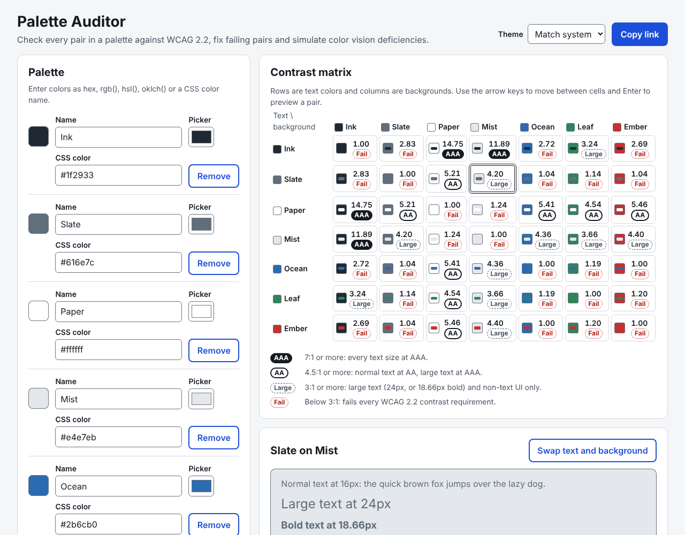

# contrastkit

Check colors against WCAG 2.2 contrast, fix failing pairs by changing their OKLCH lightness,
and simulate color vision deficiencies. contrastkit is a TypeScript library with no runtime
dependencies, a command-line tool for CI pipelines, and a web app called Palette Auditor.

[](https://github.com/ult666666/contrastkit/actions/workflows/ci.yml)
[](LICENSE)
[](tsconfig.base.json)

[Open Palette Auditor](https://ult666666.github.io/contrastkit/) to edit a palette, see the
contrast of every pair and apply suggested fixes. The address bar holds the palette, so a link
reopens it.



## Install

contrastkit is not on npm. Install the library and the `contrastkit` command from the GitHub
release, which also attaches a SHA-256 checksum (Node 22 or newer):

```sh
npm install https://github.com/ult666666/contrastkit/releases/download/v0.1.0/contrastkit-0.1.0.tgz
npx contrastkit check 777 fff
```

To build from source, clone the repository and run `npm ci && npm run build`.

## Library

[`examples/library.mjs`](examples/library.mjs):

```js
import {
  auditPalette,
  checkContrast,
  formatHex,
  formatRatio,
  simulateCvd,
  suggestFix,
} from 'contrastkit';

const result = checkContrast('#777777', '#ffffff');
console.log(`#777777 on white: ${formatRatio(result.ratio)}, AA text: ${result.aaText}`);

const fix = suggestFix('#777777', '#ffffff', { level: 'AA' });
if (fix.status === 'fixed') {
  const [best] = fix.candidates;
  console.log(
    `closest AA fix: ${best.hex} (${formatRatio(best.ratio)}, ΔE_OK ${best.deltaE.toFixed(3)})`,
  );
}

console.log(
  `#c53030 with deuteranopia looks like ${formatHex(simulateCvd('#c53030', 'deuteranopia'))}`,
);

const audit = auditPalette({
  text: '#1f2933',
  surface: '#ffffff',
  success: '#2f855a',
  danger: '#c53030',
});
for (const { type, a, b, deltaE } of audit.cvdConfusions) {
  console.log(`hard to tell apart with ${type}: ${a} / ${b} (ΔE_OK ${deltaE.toFixed(3)})`);
}
```

```console
$ node examples/library.mjs
#777777 on white: 4.47:1, AA text: false
closest AA fix: #767676 (4.54:1, ΔE_OK 0.003)
#c53030 with deuteranopia looks like #82752a
hard to tell apart with deuteranopia: success / danger (ΔE_OK 0.063)
```

Ratios are truncated for display (4.478… shows as 4.47:1), so a value just below a threshold
never looks like a pass.

Anomalous trichromacy takes a severity from 0 (typical vision) to 1 (the matching
dichromacy):

```js
formatHex(simulateCvd('#c53030', 'deuteranomaly', 0.3)); // '#a7572c'
formatHex(simulateCvd('#c53030', 'deuteranomaly', 0.6)); // '#93682b'
formatHex(simulateCvd('#c53030', 'deuteranomaly', 1)); // '#82752a', same as 'deuteranopia'
auditPalette(palette, { cvdTypes: [{ type: 'deuteranomaly', severity: 0.6 }] });
```

## Command line

Run it from the repository with `npx contrastkit`. Hex colors may omit the `#`, because an
unquoted `#` starts a comment in most shells.

```console
$ npx contrastkit check 777 fff
#777777 on #ffffff: 4.47:1

  FAIL  AA   normal text  needs 4.5:1
  PASS  AA   large text   needs 3:1
  FAIL  AAA  normal text  needs 7:1
  FAIL  AAA  large text   needs 4.5:1
  PASS  AA   non-text UI  needs 3:1

Fails AA for normal text: 4.47:1 is below 4.5:1.
```

```console
$ npx contrastkit fix 2f80ed fff --level AAA
#2f80ed on #ffffff: 3.86:1, target 7:1 (AAA for normal text)

Suggestions, closest first (only OKLCH lightness changes):
  1.  #0053bd     7.06:1  ΔE_OK 0.140  darker   oklch(46.92% 0.1807 258.87)

Closest fix: #0053bd
```

| Command                           | Options                                                                   |
| --------------------------------- | ------------------------------------------------------------------------- |
| `contrastkit check <fg> <bg>`     | `--level AA\|AAA`, `--large`, `--target <ratio>`, `--cvd <sim>`, `--json` |
| `contrastkit fix <fg> <bg>`       | `--level AA\|AAA`, `--large`, `--target <ratio>`, `--json`                |
| `contrastkit audit <tokens.json>` | `--require AA\|AAA`, `--cvd <sim>`, `--json`                              |

`--cvd` takes a dichromacy (`deuteranopia`) or an anomalous trichromacy with a severity
(`deuteranomaly:0.6`) and can be repeated. `check` then adds the simulated pair and its color
difference; the WCAG checks always use the colors as given:

```console
$ npx contrastkit check 2f855a c53030 --cvd deuteranomaly:0.6 --cvd deuteranopia
...
Color vision simulation (Machado et al. 2009; the checks use the actual colors)
  deuteranomaly:0.6  #6e785c on #93682b  ΔE_OK 0.076 (typical vision 0.269)
  deuteranopia       #78735d on #82752a  ΔE_OK 0.063 (typical vision 0.269)
```

Exit codes: `0` passed (or a fix was found), `1` a check failed or no fix reaches the target,
`2` invalid usage or input. On a terminal the output includes 24-bit color swatches; set
`NO_COLOR=1` to turn them off.

## Use it in CI

Describe your colors and the pairs that must pass in a tokens file, like
[`examples/tokens.json`](examples/tokens.json), and audit it:

```console
$ npx contrastkit audit examples/tokens.json
...
Declared pairs
  PASS  text.primary on surface.default   14.67:1  AA text (needs 4.5:1)
  PASS  text.muted on surface.subtle       6.86:1  AA text (needs 4.5:1)
  PASS  brand.primary on surface.default   5.16:1  AA text (needs 4.5:1)
  PASS  text.inverse on brand.primary      5.16:1  AA text (needs 4.5:1)
  PASS  status.danger on surface.default   6.47:1  AA text (needs 4.5:1)
  PASS  status.success on surface.subtle   4.55:1  AA large text (needs 3:1)
  PASS  border.strong on surface.default   4.83:1  AA non-text (needs 3:1)

Color vision warnings (ΔE_OK below 0.08 after simulation)
  WARN  protanopia    status.success / status.warning: ΔE_OK 0.068 (typical vision 0.220)
  WARN  deuteranopia  status.success / status.warning: ΔE_OK 0.069 (typical vision 0.220)
  WARN  deuteranopia  status.success / status.danger: ΔE_OK 0.042 (typical vision 0.289)
  WARN  deuteranopia  status.warning / status.danger: ΔE_OK 0.049 (typical vision 0.091)
  WARN  tritanopia    brand.primary / status.success: ΔE_OK 0.069 (typical vision 0.297)
  WARN  tritanopia    status.warning / status.danger: ΔE_OK 0.053 (typical vision 0.091)

Result: all 7 checked pairs pass.
```

The full output also lists the colors and the contrast matrix. Color-vision confusions are
warnings; a failing pair makes the command exit with code 1. [docs/CI.md](docs/CI.md) explains
the tokens format, gives a GitHub Actions job, and shows how a file downloaded from Palette
Auditor goes through the same audit.

## How it works

Contrast is `(L1 + 0.05) / (L2 + 0.05)` on WCAG relative luminance. It linearizes sRGB at the
standard's 0.04045 threshold, where WCAG 2.0 printed 0.03928; for 8-bit colors the two give the
same result, which the tests check for every channel value. A fix is a binary search on OKLCH
lightness towards black and towards white. Every probe is gamut-mapped and rounded to 8 bits, so
the hex that comes back is the color that was measured to pass. Color vision deficiencies are
simulated with Machado, Oliveira and Fernandes's (2009) matrices in linear RGB, interpolated
linearly between their published 0.1 severity steps.

[docs/DESIGN.md](docs/DESIGN.md) covers the math, the algorithms, the accessibility decisions in
the app, the trade-offs and the references.

## Testing

`npm test` runs 357 tests: 287 for the library and CLI, with 99.71% statement coverage, and 70
for the web app. The color-vision simulation agrees with two independent Python
implementations, colorspacious and DaltonLens, on 1,800 simulations. axe-core reports no
violations in the app in jsdom or in Chromium, in light and dark themes; the browser run skips
only the preview sample, which shows your colors at their own contrast on purpose. CI also runs
the README's command transcripts and library example and checks that they print what is shown
here. [docs/DESIGN.md](docs/DESIGN.md#10-how-correctness-is-verified) describes each check.

## Development

| Command                  | What it does                                                 |
| ------------------------ | ------------------------------------------------------------ |
| `npm ci`                 | Install exact dependency versions from `package-lock.json`   |
| `npm test`               | Library/CLI and app tests, with coverage                     |
| `npm run lint`           | ESLint (type-aware typescript-eslint, react-hooks, jsx-a11y) |
| `npm run format:check`   | Prettier                                                     |
| `npm run typecheck`      | `tsc` for both workspaces                                    |
| `npm run build`          | Library (ESM + CJS + .d.ts), CLI and web app                 |
| `npm run dev -w app`     | Vite dev server for the web app                              |
| `npm run preview -w app` | Serve the production build locally                           |

The repository is an npm workspace: `packages/contrastkit` holds the library and CLI, and
`app` the web app. Development needs Node 22.22.2+ or 24.15+.
[docs/DESIGN.md](docs/DESIGN.md#11-toolchain-notes) explains why two toolchain packages stay
below their latest major version, and `.github/workflows/pages.yml` deploys the app to GitHub
Pages.

## Limits

- WCAG 2 contrast is a coarse model of legibility, and passing it does not prove text is
  readable. APCA, proposed for WCAG 3, is not implemented because its reference code has
  restrictive licensing.
- Color-vision simulation models an average observer. Severity is a model parameter, not a
  clinical measurement, and the tritan simulations are the least reliable.
- Fixes change lightness only, so a hue or chroma change could sometimes be closer.
- Only sRGB is supported: no Display P3, translucent backgrounds, or `lab()`, `lch()`, `hwb()`
  and `color()` syntax.

[docs/DESIGN.md](docs/DESIGN.md#limits-and-roadmap) has the full list and the roadmap.

Built with AI coding assistants. I reviewed the code and the tests that check it.

## License

[MIT](LICENSE) © 2026 Charles Dai
